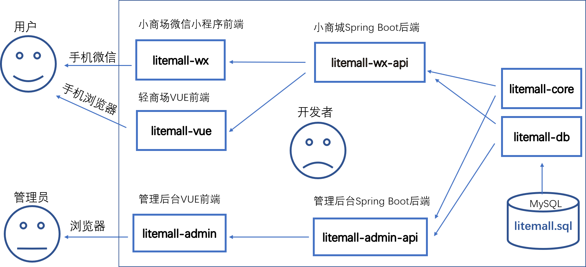
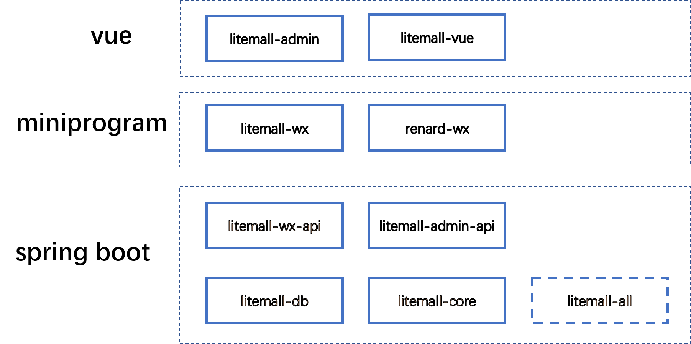

# litemall（个人学习改造版）

> 本项目 Fork 自 [linlinjava/litemall](https://github.com/linlinjava/litemall)，
> 保留原始 LICENSE 与版权声明。以下为我基于源码研读所做的分析与改造。


## 我发现的问题与改造

### 1. 订单表无二级索引导致的全表扫描与 filesort

**现象**

「我的订单」接口 `/wx/order/list` → `LitemallOrderService.queryByOrderStatus()`（`LitemallOrderService.java:77`），实际 SQL：

```sql
SELECT * FROM litemall_order
WHERE user_id = ? AND deleted = 0 AND order_status IN (?)
ORDER BY add_time DESC LIMIT ?, ?;
```

而 `litemall_table.sql:591` 中该表只有 `PRIMARY KEY (id)`。10 万行数据下：

| type | key | rows | filtered | Extra |
|------|-----|------|----------|-------|
| `ALL` | `NULL` | **99507** | `0.01%` | `Using where; Using filesort` |

`EXPLAIN ANALYZE` 实测 **85.6 ms**（Table scan 80.8 ms + Sort 5 ms）。

**影响**

- ① 每次查订单扫近 10 万行，订单表增长最快，扫描量线性膨胀并挤占 buffer pool；
- ② 排序用不上索引，超出 `sort_buffer_size` 落磁盘临时文件；
- ③ 命中率仅 0.01%，99.98% 的 IO 是浪费；
- ④ `order_sn` 无唯一约束，`generateOrderSn()` 的 `count` 预检是 check-then-act，并发下会撞号（源码 `LitemallOrderService.java:66` 注释已承认）。

**改造**

```sql
ALTER TABLE litemall_order
   ADD UNIQUE KEY uk_order_sn (order_sn),
   ADD KEY idx_user_deleted_time (user_id, deleted, add_time),
   ADD KEY idx_user_status_time (user_id, deleted, order_status, add_time);
```

> 上述索引已合并进 `litemall-db/sql/litemall_table.sql` 的建表语句，新建库导入即生效；
> 已有数据的库执行上面的 `ALTER TABLE` 增量补索引即可，无需重建表。

- 按「等值列在前、排序列在后」布局，前三列等值过滤、`add_time` 直接提供倒序，排序由索引满足。
- 「全部订单」不带 `order_status`，若复用上面那条会因中间列缺失导致最左前缀断裂、`add_time` 无法排序，故单独保留 `idx_user_deleted_time`。
- `deleted` 区分度≈0 不能放最左，但作为等值条件放在 `user_id` 之后不影响后续列。
- 唯一性从应用层预检下沉为数据库约束兜底；Java 代码无需改动。

### 2. 优惠券核销存在越权使用与重复抵扣

**现象**

`WxOrderService.submit()`（`WxOrderService.java:439`）核销优惠券是典型的 check-then-act：

```java
LitemallCouponUser couponUser = couponUserService.findById(userCouponId);
couponUser.setStatus(CouponUserConstant.STATUS_USED);
couponUser.setOrderId(orderId);
couponUserService.update(couponUser);   // 按主键覆盖，没有任何状态条件
```

而校验入口 `CouponVerifyService.checkCoupon()`（`CouponVerifyService.java:33`）只校验了券模板是否存在、是否超期、是否满足门槛金额，**两件事没有校验**：

1. **券的归属**：`findById(userCouponId)` 拿到即用，不比对 `couponUser.getUserId()` 与当前用户；
2. **券的状态**：已置为 `STATUS_USED` 的券再次传入，仍会被判定为可用。

**影响**

| 场景 | 结果 |
|------|------|
| 传入他人的 `userCouponId` | 可用别人的券抵扣自己的订单（越权 + 资损） |
| 同一 `userCouponId` 连续下两单 | 两单均抵扣成功，`order_id` 被第二单覆盖（**串行即可复现，无需并发**） |
| 两个请求并发提交同一张券 | 两个订单同时核销成功（check-then-act 竞态） |

**改造**

三处配合，把「判断 + 修改」收敛为一条原子 SQL：

1. `LitemallCouponUserService.useCoupon()` 新增条件更新，把归属、状态、未删除全部写进 `WHERE`，以影响行数判定是否占用成功：

```java
LitemallCouponUser record = new LitemallCouponUser();
record.setStatus(CouponUserConstant.STATUS_USED);
record.setUsedTime(LocalDateTime.now());
record.setOrderId(orderId);

LitemallCouponUserExample example = new LitemallCouponUserExample();
example.or()
        .andIdEqualTo(id)
        .andUserIdEqualTo(userId)
        .andStatusEqualTo(CouponUserConstant.STATUS_USABLE)
        .andDeletedEqualTo(false);
return couponUserMapper.updateByExampleSelective(record, example);
```

2. `CouponVerifyService.checkCoupon()` 补两道校验：`couponUser.getUserId()` 必须等于当前用户、`getStatus()` 必须为 `STATUS_USABLE`，防止校验层与写入层结论不一致。

3. `WxOrderService.submit()` 改为依据 `useCoupon()` 的返回值判定，失败即抛异常，由 `@Transactional` 回滚库存扣减与订单写入：

```java
if (couponUserService.useCoupon(targetUserCouponId, userId, orderId) == 0) {
    throw new RuntimeException("优惠券已被使用");
}
```

**验证**

下单前后查询券状态：

```sql
SELECT id, user_id, status, order_id FROM litemall_coupon_user WHERE id = ?;
```

| 场景 | 改前 | 改后 |
|------|------|------|
| 同一 `userCouponId` 连续提交两单 | 两单均抵扣成功 | 第二单抛「优惠券已被使用」，事务回滚 |
| 用户 A 提交用户 B 的 `userCouponId` | 抵扣成功 | `checkCoupon` 返回 null，下单失败 |
| 并发提交同一张券 | 两单均成功 | 仅一单成功 |

正确性由数据库保证：条件更新在 InnoDB 行锁下串行化，同一行只有一个事务能命中 `status = 0` 并拿到 `affected rows = 1`，其余返回 0。

### 3. 同一用户并发下单产生重复订单

**现象**

`WxOrderService.submit()` 把购物车结算成订单，是典型的 check-then-act：

```java
// ① 读取购物车 —— 普通 SELECT，RR 隔离级别下是快照读，不加任何锁
if (cartId.equals(0)) {
    checkedGoodsList = cartService.queryByUidAndChecked(userId);
} else {
    LitemallCart cart = cartService.findById(cartId);
    checkedGoodsList = new ArrayList<>(1);
    checkedGoodsList.add(cart);
}

// ② 在 Java 里判空
if (checkedGoodsList.size() == 0) {
    return ResponseUtil.badArgumentValue();
}

// ③ 插入订单主表 / 订单商品表
orderService.add(order);

// ④ 扣减库存（判断在 SQL 的 WHERE 里，天然互斥）
if (productService.reduceStock(productId, checkGoods.getNumber()) == 0) {
    throw new RuntimeException("商品货品库存减少失败");
}

// ⑤ 清空购物车
cartService.clearGoods(userId);
```

**判断（②）与清空（⑤）之间隔着写两张表、扣库存三步**，窗口在几十毫秒量级。两个并发请求的时间线：

| 时刻 | 请求 A | 请求 B |
|------|--------|--------|
| t1 | 读到 1 条已勾选购物车 | |
| t2 | | 读到**同一条** |
| t3 | `size() == 1`，通过 | |
| t4 | | `size() == 1`，通过 |
| t5 | 插入订单 #1 | |
| t6 | | 插入订单 #2 |
| t7 | 扣库存 | 扣库存 |
| t8 | `clearGoods` 清空 | `clearGoods` 已是空操作 |

两个请求各自拿着一份**互不可见的快照**跑完全程，`clearGoods` 在最后一步才执行，救不了已经通过校验的请求。

**影响**

| 场景 | 结果 |
|------|------|
| 用户双击提交、弱网自动重试 | 同一份购物车结算出 2 张以上待支付订单 |
| 库存 | 被重复扣减，虚占至 `OrderUnpaidTask` 超时取消（默认 30 分钟）才返还 |
| 优惠券 | 多张订单争用同一张券，串行场景会被第 2 节的改造拦下，并发下仍可能双扣 |
| 支付后 | 用户对多张订单重复支付，产生重复发货 |

有三个「看起来应该能拦住、实际拦不住」的点，值得记录：

1. **库存没有超卖，订单却重复了**。因为扣库存的判断下沉到了 SQL —— `GoodsProductMapper.xml:9-13` 是 `UPDATE ... SET number = number - #{num} WHERE id = #{id} AND number >= #{num}`，由数据库保证原子性；而购物车的判空留在 Java 里。**同一个方法里两种写法并存**，对比就是这次定位问题的起点。
2. **`uk_order_sn` 拦不住**。第 1 节加的唯一索引只保证单号不重复，而 `generateOrderSn()` 每单生成随机串，两单本来就不会撞号。
3. **`@Transactional` 拦不住**。事务给的是原子性与隔离性，隔离性只保证「看不见别人未提交的修改」，不会让两个事务排队。RR 下两个普通 SELECT 各拿一份快照，谁也不阻塞谁。

**改造**

用用户维度的行锁，把同一用户的下单请求串行化。

1. `LitemallUserMapper` 新增行锁查询：

```java
@Select("SELECT id FROM litemall_user WHERE id = #{id} FOR UPDATE")
LitemallUser selectByPrimaryKeyForUpdate(@Param("id") Integer id);
```

2. `LitemallUserService.lockById()` 包一层，**不加 `@Transactional`**：

```java
public LitemallUser lockById(Integer id) {
    return userMapper.selectByPrimaryKeyForUpdate(id);
}
```

3. `WxOrderService.submit()` 在参数校验之后、读取购物车之前加锁（`WxOrderService.java:311`）：

```java
if (cartId == null || addressId == null || couponId == null) {
    return ResponseUtil.badArgument();
}

// 以用户行锁串行化同一用户的并发下单：
// 后到的请求会阻塞到前一个事务提交，此时购物车已清空，会返回参数错误
userService.lockById(userId);
```

几处取舍：

- **锁用户行而不是购物车行**：购物车行可能不存在（用户把勾选商品删光），`FOR UPDATE` 匹配不到行时只能加间隙锁，范围取决于索引与隔离级别，不可控；用户行一定存在，语义明确。
- **不加 `@Transactional`**：Spring 默认 `REQUIRED` 传播，该方法**加入** `submit()` 已开启的事务，锁一直持有到 `submit()` 提交。若写成 `REQUIRES_NEW`，方法返回即提交、锁立即释放，改造完全失效——这是最容易踩的坑。
- **锁放在参数校验之后**：校验失败会提前 `return`，没必要为注定失败的请求抢占锁。
- **行锁在数据库里，与实例数无关**：优于 `synchronized`（只在单 JVM 内有效），多实例部署下同样生效。
- **只查 `id` 不查 `*`**：本项目未开启 `map-underscore-to-camel-case`，`SELECT *` 返回的对象会有半数字段为 `null`，且加锁只关心命中哪一行。

**验证**

第一层，脱离应用验证锁本身（两个 MySQL 会话）：

```sql
-- 会话 A
BEGIN;
SELECT id FROM litemall_user WHERE id = 200005 FOR UPDATE;

-- 会话 B：执行后应阻塞、不返回
BEGIN;
SELECT id FROM litemall_user WHERE id = 200005 FOR UPDATE;

-- 回到会话 A
COMMIT;   -- 提交瞬间，会话 B 立即返回
```

第二层，应用层并发（JMeter，10 线程 + Synchronizing Timer 对齐后同时放行）：

| 指标 | 改前 | 改后 |
|------|------|------|
| `litemall_order` 中该用户订单数 | 多张 | **1 张** |
| 成功响应（`errno = 0`）个数 | 10 | 1 |
| 其余 9 个请求 | — | 返回「参数不对」，因拿到锁时购物车已被清空 |
| 失败请求耗时 | — | 明显高于成功那个，因阻塞在 `FOR UPDATE` 上排队 |

第三层，回归主流程：正常选商品、提交、支付走一遍，确认加锁未影响非并发路径。

### 4. 购物车查询缺失归属校验（越权）

**现象**

`WxOrderService.submit()` 的 `cartId != 0` 分支：

```java
LitemallCart cart = cartService.findById(cartId);
checkedGoodsList = new ArrayList<>(1);
checkedGoodsList.add(cart);
```

`LitemallCartService` 提供两个重载：

```java
public LitemallCart findById(Integer id) {              // 只按主键，谁都能查
    return cartMapper.selectByPrimaryKey(id);
}

public LitemallCart findById(Integer userId, Integer id) {
    LitemallCartExample example = new LitemallCartExample();
    example.or()
            .andUserIdEqualTo(userId)
            .andIdEqualTo(id)
            .andDeletedEqualTo(false);
    return cartMapper.selectOneByExample(example);      // 带归属条件
}
```

`submit()` 调的是**不带 `userId`** 的版本，用户 A 传入用户 B 的 `cartId` 就能用别人的购物车下单。

**影响**

| 场景 | 结果 |
|------|------|
| A 提交 B 的 `cartId` | 用 B 的购物车商品创建 A 的订单 |
| `cartId` 指向已逻辑删除的行 | `selectByPrimaryKey` 不判 `deleted`，已删除的商品仍可被结算 |

**改造**

改用带归属条件的重载，并补判空：

```java
LitemallCart cart = cartService.findById(userId, cartId);
if (cart == null) {
    // 购物车行不属于当前用户，或已被删除
    return ResponseUtil.badArgumentValue();
}
checkedGoodsList = new ArrayList<>(1);
checkedGoodsList.add(cart);
```

**判空是必须的**：`selectOneByExample` 查不到时返回 `null`，原代码直接 `add(cart)`，后续 `for` 循环会抛 `NullPointerException`。改造前不存在这个风险，因为 `selectByPrimaryKey` 在行不存在时返回的是对象而非 `null`——**换了重载就必须配套判空**。

项目内 `WxCartController.java:444`、`WxCouponController.java:142` 已是这种写法，本次只是把 `submit()` 补齐到同一标准。

**验证**

| 场景 | 改前 | 改后 |
|------|------|------|
| A 用 B 的 `cartId` 下单 | 成功 | 返回「参数不对」 |
| `cartId` 指向不存在的行 | `NullPointerException` | 返回「参数不对」 |
| 正常使用自己的 `cartId` | 成功 | 成功 |

---

# litemall

一个小商场系统。

litemall = Spring Boot后端 + Vue管理员前端 + 微信小程序用户前端 + Vue用户移动端

* [文档](https://linlinjava.gitbook.io/litemall)
* [贡献](https://linlinjava.gitbook.io/litemall/contribute)
* [FAQ](https://linlinjava.gitbook.io/litemall/faq)
* [API](https://linlinjava.gitbook.io/litemall/api)

## 项目代码

* [码云](https://gitee.com/linlinjava/litemall)
* [GitHub](https://github.com/linlinjava/litemall)

## 项目架构


## 技术栈

> 1. Spring Boot
> 2. Vue
> 3. 微信小程序



## 功能

### 小商城功能

* 首页
* 专题列表、专题详情
* 分类列表、分类详情
* 品牌列表、品牌详情
* 新品首发、人气推荐
* 优惠券列表、优惠券选择
* 团购
* 搜索
* 商品详情、商品评价、商品分享
* 购物车
* 下单
* 订单列表、订单详情、订单售后
* 地址、收藏、足迹、意见反馈
* 客服

### 管理平台功能

* 会员管理
* 商城管理
* 商品管理
* 推广管理
* 系统管理
* 配置管理
* 统计报表

## 快速启动

1. 配置最小开发环境：
   * [MySQL](https://dev.mysql.com/downloads/mysql/)
   * [JDK1.8或以上](http://www.oracle.com/technetwork/java/javase/overview/index.html)
   * [Maven](https://maven.apache.org/download.cgi)
   * [Nodejs](https://nodejs.org/en/download/)
   * [微信开发者工具](https://developers.weixin.qq.com/miniprogram/dev/devtools/download.html)

2. 数据库依次导入litemall-db/sql下的数据库文件
   * litemall_schema.sql
   * litemall_table.sql
   * litemall_data.sql

3. 启动小商场和管理后台的后端服务

   打开命令行，输入以下命令
    ```bash
    cd litemall
    mvn install
    mvn clean package
    java -Dfile.encoding=UTF-8 -jar litemall-all/target/litemall-all-0.1.0-exec.jar
    ```

4. 启动管理后台前端

   打开命令行，输入以下命令
    ```bash
    cd litemall/litemall-admin
    npm install --registry=https://registry.npm.taobao.org
    npm run dev
    ```
   此时，浏览器打开，输入网址`http://localhost:9527`, 此时进入管理后台登录页面。

5. 启动小商城前端

   这里存在两套小商场前端litemall-wx和renard-wx，开发者可以分别导入和测试：

   1. 微信开发工具导入litemall-wx项目;
   2. 项目配置，启用“不校验合法域名、web-view（业务域名）、TLS 版本以及 HTTPS 证书”
   3. 点击“编译”，即可在微信开发工具预览效果；
   4. 也可以点击“预览”，然后手机扫描登录（但是手机需开启调试功能）。

   注意：
> 这里只是最简启动方式，而小商场的微信登录、微信支付等功能需开发者设置才能运行，
> 更详细方案请参考[文档](https://linlinjava.gitbook.io/litemall/project)。

6. 启动轻商城前端

   打开命令行，输入以下命令
    ```bash
    cd litemall/litemall-vue
    npm install --registry=https://registry.npm.taobao.org
    npm run dev
    ```
   此时，浏览器（建议采用chrome 手机模式）打开，输入网址`http://localhost:6255`, 此时进入轻商场。

   注意：
   > 现在功能很不稳定，处在开发阶段。

## 警告

> 1. 本项目仅用于学习练习
> 2. 本项目还不完善，仍处在开发中，不承担任何使用后果
> 3. 本项目代码开源[MIT](./LICENSE)，项目文档采用 [署名-禁止演绎 4.0 国际协议许可](https://creativecommons.org/licenses/by-nd/4.0/deed.zh)

## 致谢

本项目基于或参考以下项目：

1. [nideshop-mini-program](https://github.com/tumobi/nideshop-mini-program)

   项目介绍：基于Node.js+MySQL开发的开源微信小程序商城（微信小程序）

   项目参考：

   1. litemall项目数据库基于nideshop-mini-program项目数据库；
   2. litemall项目的litemall-wx模块基于nideshop-mini-program开发。

2. [vue-element-admin](https://github.com/PanJiaChen/vue-element-admin)

   项目介绍： 一个基于Vue和Element的后台集成方案

   项目参考：litemall项目的litemall-admin模块的前端框架基于vue-element-admin项目修改扩展。

3. [mall-admin-web](https://github.com/macrozheng/mall-admin-web)

   项目介绍：mall-admin-web是一个电商后台管理系统的前端项目，基于Vue+Element实现。

   项目参考：litemall项目的litemall-admin模块的一些页面布局样式参考了mall-admin-web项目。

4. [biu](https://github.com/CaiBaoHong/biu)

   项目介绍：管理后台项目开发脚手架，基于vue-element-admin和springboot搭建，前后端分离方式开发和部署。

   项目参考：litemall项目的权限管理功能参考了biu项目。

5. [vant--mobile-mall](https://github.com/qianzhaoy/vant--mobile-mall)

   项目介绍：基于有赞 vant 组件库的移动商城。

   项目参考：litemall项目的litemall-vue模块基于vant--mobile-mall项目开发。

## 推荐

1. [Flutter_Mall](https://github.com/youxinLu/mall)

   项目介绍：Flutter_Mall是一款Flutter开源在线商城应用程序。

2. [Taro_Mall](https://github.com/jiechud/taro-mall)

   项目介绍：Taro_Mall是一款多端开源在线商城应用程序，后台是基于litemall基础上进行开发，前端采用Taro框架编写。


## License

[MIT](https://github.com/linlinjava/litemall/blob/master/LICENSE)
Copyright (c) 2018-present linlinjava
